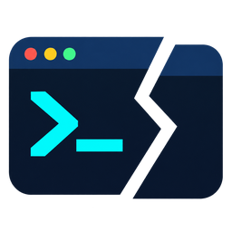
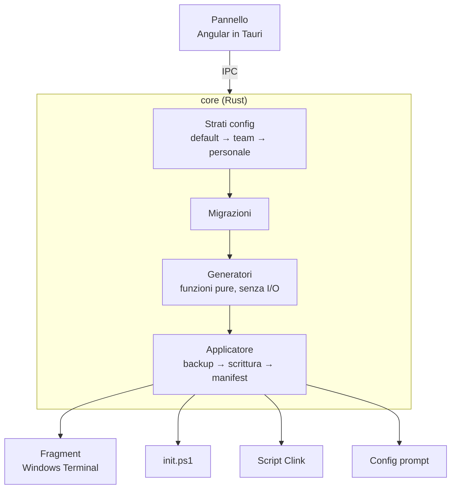

<div align="center">



# CLI Superpower

**Configura Windows Terminal, PowerShell e cmd da un pannello grafico.**<br />
Niente JSON da imparare, niente profili scritti a mano. Scegli, premi *Applica*, e puoi sempre tornare indietro.

[](https://github.com/anto88ct/CLI-superpower/actions/workflows/ci.yml)
[](https://anto88ct.github.io/CLI-superpower/)


[Sito](https://anto88ct.github.io/CLI-superpower/) ·
[Documento di progetto](PROGETTO.md) ·
[Schema della configurazione](docs/config-schema.md) ·
[Spike di fase 0](docs/spikes/fase-0.md)

</div>

---

> [!NOTE]
> Il progetto è in **fase 0**: fondamenta, spike tecnici e architettura. Non esiste ancora una release scaricabile. Le funzionalità elencate sotto descrivono la v1 in sviluppo.

## Indice

- [Cos'è](#cosè)
- [Cosa risolve](#cosa-risolve)
- [Come funziona](#come-funziona)
- [Funzionalità e roadmap](#funzionalità-e-roadmap)
- [Sicuro per costruzione](#sicuro-per-costruzione)
- [Il comando `csp`](#il-comando-csp)
- [Stack](#stack)
- [Struttura del repository](#struttura-del-repository)
- [Sviluppo](#sviluppo)
- [Contribuire](#contribuire)

## Cos'è

CLI Superpower è un'app desktop per Windows che **scrive al posto tuo** la configurazione del terminale: aspetto per singola shell, comandi rapidi con parametri, prompt informativo, workspace di progetto, pacchetto condiviso con il team.

Non è un nuovo terminale né una nuova shell. Usa **Windows Terminal**, **PowerShell** e **cmd** che hai già, e li configura nel modo in cui li configurerebbe un esperto.

```text
PS C:\progetti\efm> /mig AggiungiUtenti
→ dotnet ef migrations add AggiungiUtenti

PS C:\progetti\efm> csp port 4200
PID 18432 | 127.0.0.1:4200
  Nome: node.exe
  Percorso: C:\Program Files\nodejs\node.exe
  In esecuzione da 0g 01h 12m 08s
Per terminare un processo, digita termina <PID>. Invio per annullare:
```

## Cosa risolve

| Oggi | Con CLI Superpower |
| --- | --- |
| Comandi lunghi ripetuti ogni giorno | Comandi rapidi con parametri: `/ndev`, `/mig Nome` |
| Terminale spoglio e tutto uguale | Tema, font, sfondo e trasparenza **per singola shell** |
| Prompt muto | Branch git, stato, versione di Node/.NET, durata ed esito dell'ultimo comando |
| Avviare un progetto richiede più finestre | Un workspace apre tab e pannelli già nelle cartelle giuste |
| Ognuno configura a mano, in modo diverso | Pacchetto team condiviso + preferenze personali che non si perdono |
| "Chi occupa la porta 4200?" | `csp port 4200` |

## Come funziona

Il terminale è fatto di tre strati. Ogni funzionalità vive in uno strato preciso, e l'app scrive solo i file che le servono.

| Strato | Cosa controlla | Come lo configuriamo |
| --- | --- | --- |
| **Terminale** · Windows Terminal | Colori, font, sfondi, tab, pannelli | JSON fragment in una cartella dell'app |
| **Shell** · PowerShell 7, Windows PowerShell 5.1, cmd | Comandi rapidi, prompt, cronologia | `init.ps1` generato · Clink con script Lua |
| **Programmi** | Output e utility | Tool esterni via winget + il comando `csp` |



I **generatori** ricevono la configurazione e restituiscono testo: si testano con snapshot, senza Windows e senza mock. L'**applicatore** è l'unico modulo che tocca il disco.

## Funzionalità e roadmap

| | Funzionalità | Strato | Release |
| --- | --- | --- | :---: |
| 🎨 | Aspetto per profilo, con "Copia aspetto su…" | Terminale | **v1** |
| ⚡ | Comandi rapidi con parametri e scope per shell | Shell | **v1** |
| 👥 | Pacchetto team + preferenze personali | Tutti | **v1** |
| 🗂️ | Workspace di progetto (tab e pannelli) | Terminale | **v1** |
| 🧭 | Prompt informativo (git, versioni, durata, esito) | Shell | **v1** |
| 🔌 | `csp port`: chi occupa la porta | Programmi | **v1** |
| 🧰 | Gestione tool esterni con winget | Programmi | **v1** |
| ♻️ | Backup, ripristino, disinstallazione pulita | Tutti | **v1** |
| | Autocomplete predittivo, help con esempi, zoxide e fzf, quake mode, preset per stack, notifiche, `csp table` | | v2 |
| | `csp view`, lazygit integrato | | v3 |

**Shell supportate:** PowerShell 7 (primaria) e Windows PowerShell 5.1 dalla v1; cmd con Clink dalla v2.

<details>
<summary><b>Tool esterni gestiti</b></summary>

<br />

| Tool | A cosa serve |
| --- | --- |
| PowerShell 7 | Shell moderna |
| Clink | Autocomplete, cronologia e macro per cmd |
| Oh My Posh / Starship | Prompt |
| Nerd Font | Icone nel terminale |
| zoxide, fzf + PSFzf | Salto tra cartelle e ricerca fuzzy |
| tealdeer | Help con esempi |
| eza, bat, jq | File, sorgenti e JSON leggibili |
| lazygit | Interfaccia git testuale |

</details>

## Sicuro per costruzione

CLI Superpower tocca il tuo sistema il meno possibile, e ogni modifica si annulla.

- **Non distruttivo.** Scrive nei propri file. In `$PROFILE` aggiunge solo un blocco delimitato; in `settings.json` tocca solo le chiavi gestite, con backup.
- **Dichiarativo.** La configurazione salvata è l'unica fonte di verità; i file di sistema sono generati.
- **Idempotente.** Applicare due volte dà lo stesso risultato. Nessuna riga accodata due volte.
- **Reversibile.** Un manifest registra ogni file scritto con il suo hash. Se l'hai modificato a mano, l'app non sovrascrive e ti mostra le differenze.
- **Disinstallazione pulita.** Rimuove fragment, script e blocchi inseriti, e riporta il sistema allo stato iniziale.

Ecco tutto ciò che l'app aggiunge al tuo `$PROFILE`:

```powershell
# >>> CLI Superpower >>> (non modificare: gestito automaticamente)
if (Test-Path "$env:LOCALAPPDATA\CliSuperpower\generated\init.ps1") {
    . "$env:LOCALAPPDATA\CliSuperpower\generated\init.ps1"
}
# <<< CLI Superpower <<<
```

<details>
<summary><b>Dove scrive l'app</b></summary>

<br />

| Percorso | Proprietario | Contenuto |
| --- | --- | --- |
| `%APPDATA%\CliSuperpower\config.personal.json` | App | Preferenze personali |
| `%APPDATA%\CliSuperpower\team\*.json` | App | Pacchetti team e preset |
| `%LOCALAPPDATA%\CliSuperpower\generated\` | App | `init.ps1`, macro, config prompt |
| `%LOCALAPPDATA%\CliSuperpower\backups\` | App | Backup con rotazione |
| `%LOCALAPPDATA%\CliSuperpower\manifest.json` | App | Registro delle scritture |
| `%LOCALAPPDATA%\Microsoft\Windows Terminal\Fragments\CliSuperpower\` | App | Fragment JSON e immagini |
| `$PROFILE` di pwsh e powershell.exe | Utente | Solo il blocco delimitato |
| `settings.json` di Windows Terminal | Utente | Solo le chiavi globali gestite |

</details>

## Il comando `csp`

`csp` è il compagno da riga di comando dell'app, scritto in Rust. Funziona uguale in ogni shell.

```powershell
csp port 4200     # processi in ascolto TCP sulla porta, con opzione per terminarli
csp --help
```

In arrivo: `csp table` per trasformare l'output in tabelle copiabili, `csp notify` per i comandi lunghi, `csp view` per una vista interattiva.

## Stack

| Ambito | Scelta |
| --- | --- |
| Desktop | [Tauri 2](https://tauri.app), installer NSIS per utente, senza privilegi di amministratore |
| Logica | Rust (workspace Cargo), serde, snapshot test |
| Interfaccia | Angular 22 con standalone components e signals |
| API di sistema | `windows-sys` per tabella TCP, processi e percorsi noti |
| Test | `cargo test`, Vitest |
| CI/CD | GitHub Actions su runner Windows, GitHub Pages per la landing |

## Struttura del repository

```text
CLI-superpower/
├─ crates/
│  ├─ core/          config, strati, migrazioni, generatori, applicatore
│  └─ csp/           comando da terminale
├─ app/
│  ├─ src/           frontend Angular
│  └─ src-tauri/     backend Tauri, espone core alla UI
├─ docs/
│  ├─ config-schema.md
│  └─ spikes/        verifiche tecniche di fase 0
├─ landing/          sito statico pubblicato su GitHub Pages
├─ PROGETTO.md       documento di progetto
└─ PRODUCT.md        posizionamento e principi di design
```

## Sviluppo

### Prerequisiti

- Windows 10 o 11 con [Windows Terminal](https://aka.ms/terminal)
- [Rust](https://rustup.rs) stabile, con `rustfmt` e `clippy`
- [Node.js](https://nodejs.org) 24 e npm
- [Prerequisiti di Tauri](https://tauri.app/start/prerequisites/) per Windows (WebView2, Build Tools di Visual Studio)

### Avvio

```bash
cd app
npm ci
npm run fetch-clink
```

Interfaccia nel browser, con chiamate a Tauri simulate:

```bash
npm start
```

App desktop completa:

```bash
npm run tauri dev
```

### Verifiche

Le stesse eseguite dalla CI:

```bash
cargo fmt --all -- --check
cargo clippy --workspace --all-targets -- -D warnings
cargo test --workspace
```

```bash
cd app && npm run build && npm test -- --watch=false
```

## Contribuire

Prima di aprire una pull request leggi [PROGETTO.md](PROGETTO.md) e [CLAUDE.md](CLAUDE.md). In breve:

1. I generatori sono funzioni pure, ognuno con il suo snapshot test.
2. Solo l'applicatore scrive su disco, sempre passando da backup e manifest.
3. Ogni modifica alle struct di configurazione incrementa `schemaVersion` e porta con sé migrazione e test.
4. I percorsi di sistema si risolvono a runtime, mai scritti nel codice.
5. Test Rust, clippy, test Angular e build devono passare.

<div align="center">
<br />
<sub>Fatto per chi passa la giornata nel terminale · codice scritto con <a href="https://claude.com/claude-code">Claude Code</a>, revisione umana</sub>
</div>
